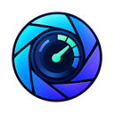
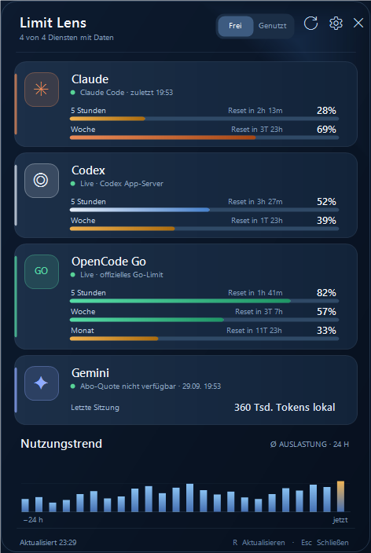

# Limit Lens

<p align="center">
  
</p>

<p align="center">
  Eine native Windows-App, die Nutzungslimits von Claude Code, Codex, OpenCode Go und Gemini CLI an einem Ort sichtbar macht.
</p>

<p align="center">
  
  
  
</p>

Limit Lens läuft unaufdringlich im Infobereich der Windows-Taskleiste. Ein Klick öffnet ein kompaktes Dashboard mit verbleibenden oder verbrauchten Kontingenten, Resetzeiten, Warnfarben und einem lokalen 24-Stunden-Trend. Die App benötigt weder NuGet-Pakete noch einen eigenen Server.



> Die Vorschau enthält ausschließlich Beispieldaten. Im laufenden Programm werden fehlende oder nicht zuverlässig verfügbare Werte klar als solche gekennzeichnet.

## Inhalt

- [Funktionen](#funktionen)
- [Unterstützte Anbieter](#unterstützte-anbieter)
- [Installation](#installation)
- [Anbieter einrichten](#anbieter-einrichten)
- [Bedienung](#bedienung)
- [Datenschutz und Sicherheit](#datenschutz-und-sicherheit)
- [Lokale Dateien und Änderungen](#lokale-dateien-und-änderungen)
- [Selbst bauen](#selbst-bauen)
- [Diagnose und Tests](#diagnose-und-tests)
- [Konfiguration über Umgebungsvariablen](#konfiguration-über-umgebungsvariablen)
- [Architektur](#architektur)
- [Bekannte Einschränkungen](#bekannte-einschränkungen)
- [Fehlerbehebung](#fehlerbehebung)
- [Mitwirken](#mitwirken)
- [Lizenz](#lizenz)

## Funktionen

- Gemeinsames Dashboard für vier Coding-Assistenten
- Umschaltung zwischen **frei** und **genutzt**
- Resetzeiten für verfügbare Quotenfenster
- Warnfarben bei knappen Kontingenten
- Desktop-Benachrichtigung beim Übergang auf höchstens 20 % Restkontingent
- Lokaler 24-Stunden-Nutzungstrend
- Automatische Aktualisierung alle fünf Minuten
- Sofortige Aktualisierung per Mausklick, `R` oder `F5`
- Native Windows-Tray-Integration und sichtbarer Taskleisten-Eintrag bei geöffnetem Popup
- Optionale Einrichtung der Claude-Code-Status-Line
- Optionaler Autostart mit Windows
- DPI-Anpassung für kleinere und hochauflösende Displays
- Einzelinstanzschutz: Limit Lens läuft nur einmal pro Benutzerkonto
- Keine Telemetrie, keine Werbung und kein Analyse-SDK

## Unterstützte Anbieter

| Anbieter | Angezeigte Daten | Datenquelle | Netzwerkzugriff durch Limit Lens |
| --- | --- | --- | --- |
| **Claude Code** | 5-Stunden- und Wochenquote | Claude-Code-Status-Line | Nein |
| **Codex** | Vom Konto gemeldete Quotenfenster und Resetzeiten | Lokaler `codex app-server` | Nein, der gestartete Codex-Prozess verwaltet seinen eigenen Zugriff |
| **OpenCode Go** | 5-Stunden-, Wochen- und Monatsquote | `https://opencode.ai/zen/go/v1/usage` | Ja, direkte HTTPS-Abfrage mit dem lokalen OpenCode-Key |
| **Gemini CLI** | Tokenzahl der letzten lokalen Sitzung | Lokale Gemini-Sitzungsdatei | Nein |

### Genauigkeit der Werte

- **Claude Code:** Limit Lens zeigt nur Werte, die Claude Code selbst an die Status-Line übergibt.
- **Codex:** Es werden ausschließlich die Quotenfenster angezeigt, die der lokale App-Server meldet. Fehlende Fenster werden nicht geschätzt.
- **OpenCode Go:** Prozentwerte und Resetzeiten stammen aus der Go Usage API.
- **Gemini CLI:** Eine unabhängige Abo-Restquote ist nicht verfügbar. Limit Lens zeigt deshalb bewusst nur lokal gezählte Sitzungstokens.

## Installation

### Fertige Version verwenden

1. `LimitLens.exe` aus dem neuesten Release herunterladen.
2. Die Datei in einen dauerhaft verfügbaren Ordner verschieben, beispielsweise `%LOCALAPPDATA%\Programs\LimitLens`.
3. `LimitLens.exe` starten.
4. Optional im Rechtsklickmenü **Mit Windows starten** aktivieren.

Limit Lens benötigt Windows 11 und das .NET Framework 4.8. Auf aktuellen Windows-11-Systemen ist die benötigte Laufzeit üblicherweise bereits vorhanden.

Nicht signierte Community-Builds können eine Windows-SmartScreen-Warnung auslösen. Prüfe in diesem Fall die Release-Quelle und veröffentlichte Prüfsummen oder baue die Anwendung selbst aus dem Quellcode.

### Tray-Symbol finden

Nach dem Start erscheint Limit Lens im Infobereich der Taskleiste. Windows kann neue Symbole zunächst hinter dem Pfeil für ausgeblendete Symbole ablegen. Solange das Dashboard geöffnet ist, besitzt die App zusätzlich einen normalen Taskleisten-Eintrag.

## Anbieter einrichten

Du kannst Limit Lens auch verwenden, wenn nur ein Teil der Anbieter eingerichtet ist. Nicht verfügbare Quellen blockieren die übrigen Karten nicht.

### Claude Code

1. Limit Lens mit der rechten Maustaste im Infobereich anklicken.
2. **Claude verbinden** auswählen.
3. Den Dialog bestätigen.
4. Claude Code starten oder eine bestehende Sitzung aktualisieren.

Wenn noch keine Status-Line eingerichtet ist, sichert Limit Lens `~/.claude/settings.json` und trägt seinen Bridge-Befehl ein. Existiert bereits eine Status-Line, bleibt sie unverändert; Limit Lens kopiert den benötigten Befehl in die Zwischenablage, damit er manuell in die bestehende Konfiguration eingebunden werden kann.

Die Bridge speichert nur `used_percentage` und `resets_at` der unterstützten Quotenfenster. Der restliche Status-Line-Inhalt wird verworfen.

### Codex

1. Codex CLI oder die Codex-App installieren.
2. In Codex mit dem gewünschten Konto anmelden.
3. Limit Lens aktualisieren.

Limit Lens sucht `codex.exe` zuerst im Installationsverzeichnis der Codex-App und anschließend über `PATH`. Für eine benutzerdefinierte Installation kann `LIMITLENS_CODEX_EXE` gesetzt werden.

Intern startet Limit Lens kurzzeitig:

```text
codex app-server --stdio
```

Anschließend wird über JSON-RPC `account/rateLimits/read` abgefragt und der Hilfsprozess wieder beendet.

### OpenCode Go

OpenCode muss auf demselben Windows-Benutzerkonto eingerichtet sein:

```powershell
npm install -g @opencode/cli
opencode
```

Danach innerhalb von OpenCode:

```text
/connect
```

1. **OpenCode Go** auswählen.
2. Bei [opencode.ai/auth](https://opencode.ai/auth) mit dem Go-Konto anmelden.
3. Den dort erzeugten API-Key in OpenCode einfügen.
4. Optional mit `/models` ein Go-Modell auswählen.
5. Limit Lens aktualisieren.

Limit Lens liest den Key bei OpenCode v2 schreibgeschützt aus der aktiven Credential-Zeile in:

```text
%USERPROFILE%\.local\share\opencode\opencode.db
```

Das ältere OpenCode-v1-Format wird weiterhin unterstützt:

```text
%USERPROFILE%\.local\share\opencode\auth.json
```

Unterstützte Integrationen sind `opencode-go` und `opencode`. Für den schreibgeschützten SQLite-Zugriff verwendet Limit Lens das mit der npm-Installation vorhandene Node.js und dessen eingebautes `node:sqlite`. Alternativ kann ein expliziter Go-API-Key über `LIMITLENS_OPENCODE_API_KEY` oder `OPENCODE_API_KEY` bereitgestellt werden.

OpenCode v2 kann je nach Verbindungsart ein internes Connection-Credential speichern, das die öffentliche Go Usage API nicht als API-Key akzeptiert. Limit Lens zeigt dann **OpenCode-Key nicht gültig**. In diesem Fall muss in der OpenCode-Konsole ein echter Go-API-Key kopiert und beim erneuten `/connect` verwendet oder über eine der genannten Umgebungsvariablen bereitgestellt werden.

### Gemini CLI

1. Gemini CLI installieren und normal verwenden.
2. Mindestens eine Sitzung starten.
3. Limit Lens aktualisieren.

Die App sucht die zuletzt geänderte Datei `session-*.json` unter `~/.gemini/tmp` und summiert ausschließlich die darin enthaltenen Tokenzähler. Gemini-Anmeldedaten werden nicht gelesen.

## Bedienung

### Maus

| Aktion | Ergebnis |
| --- | --- |
| Linksklick auf das Tray-Symbol | Dashboard öffnen oder schließen |
| Rechtsklick auf das Tray-Symbol | Kontextmenü öffnen |
| **Frei / Genutzt** | Darstellung der Prozentwerte umschalten |
| Aktualisieren-Symbol | Daten sofort neu laden |
| Zahnrad | Kontextmenü öffnen |
| Schließen-Symbol | Dashboard ausblenden; die Tray-App läuft weiter |

### Tastatur

| Taste | Aktion |
| --- | --- |
| `R` oder `F5` | Aktualisieren |
| `U` | Zwischen frei und genutzt wechseln |
| `Esc` | Dashboard schließen |

### Kontextmenü

- **Aktualisieren** – alle Anbieter neu abfragen
- **Verbleibend anzeigen** – zwischen Restkontingent und Verbrauch wechseln
- **Mit Windows starten** – Autostart für das aktuelle Benutzerkonto ein- oder ausschalten
- **Claude verbinden** – Claude-Code-Status-Line einrichten
- **Über Limit Lens** – Datenquellen und Datenschutzhinweise anzeigen
- **Beenden** – Tray-App vollständig schließen

## Datenschutz und Sicherheit

Limit Lens verarbeitet Kontingentdaten lokal und besitzt keinen eigenen Backend-Dienst.

### Was die App liest

- Claude-Code-Status-Line-Werte aus dem eigenen lokalen Cache
- Codex-Quoten über den lokal gestarteten Codex App-Server
- den OpenCode-API-Key aus der lokalen OpenCode-v2-Datenbank, der älteren `auth.json` oder einer Umgebungsvariable
- Tokenzähler aus der neuesten lokalen Gemini-Sitzung

### Was die App speichert

- Prozentwerte und Resetzeitpunkte von Claude Code
- stündliche Prozent-Snapshots für den lokalen Verlauf
- ein technisches Anwendungsprotokoll ohne Zugangsdaten

### Was die App nicht speichert

- API-Keys
- OAuth-Tokens
- Prompts oder Antworten
- Quellcode oder Dateiinhalte aus deinen Projekten
- vollständige Claude- oder Gemini-Sitzungen

### Netzwerkverbindungen

Limit Lens selbst stellt nur für OpenCode Go eine externe Verbindung her:

```text
GET https://opencode.ai/zen/go/v1/usage
Authorization: Bearer <lokaler OpenCode-Key>
```

Der Key wird für diese Anfrage im Arbeitsspeicher verwendet, nicht in den Limit-Lens-Datenordner kopiert und nicht protokolliert. Codex kann innerhalb seines eigenen App-Server-Prozesses Netzwerkzugriffe durchführen; diese werden von Codex selbst verwaltet.

## Lokale Dateien und Änderungen

### Limit-Lens-Daten

Standardordner:

```text
%LOCALAPPDATA%\LimitLens
```

| Datei | Inhalt | Aufbewahrung |
| --- | --- | --- |
| `claude-status.json` | sichere Teilmenge der Claude-Quoten | bis zur nächsten Aktualisierung |
| `history.csv` | Zeit, Anbietername und Auslastungsprozent | maximal sieben Tage |
| `limitlens.log` | Start-, Sichtbarkeits- und Fehlerdiagnose | bis zur manuellen Löschung |

### Änderungen außerhalb des Datenordners

- **Claude verbinden:** kann `~/.claude/settings.json` ändern und vorher eine Datei mit dem Suffix `.limitlens-backup-<Zeitstempel>` anlegen.
- **Autostart:** setzt oder entfernt den Wert `LimitLens` unter `HKCU\Software\Microsoft\Windows\CurrentVersion\Run`.
- Alle anderen Anbieterdateien werden nur gelesen.

## Selbst bauen

### Voraussetzungen

- Windows 11
- .NET Framework 4.8 Developer Tools beziehungsweise der klassische C#-Compiler unter `%WINDIR%\Microsoft.NET\Framework64\v4.0.30319\csc.exe`
- PowerShell 5.1 oder neuer

Es gibt keine NuGet-Abhängigkeiten und keine Paketwiederherstellung.

### Build

```powershell
powershell -NoProfile -ExecutionPolicy Bypass -File .\build.ps1
```

Das Ergebnis ist `LimitLens.exe` im Projektstamm. Der Build bindet Manifest und Mehrgrößen-App-Icon direkt in die EXE ein.

### App-Icon neu erzeugen

Die hochauflösende Quelldatei liegt unter `assets/LimitLens.png`. Daraus werden die PNG-Vorschauen und `assets/LimitLens.ico` erzeugt:

```powershell
powershell -NoProfile -ExecutionPolicy Bypass -File .\tools\build-icon.ps1
```

Das ICO enthält 16, 20, 24, 32, 40, 48, 64, 128 und 256 Pixel große Varianten.

### Vorschau rendern

```powershell
.\LimitLens.exe --preview .\preview.png
```

Dieser Modus rendert das Dashboard mit fest definierten Beispieldaten und greift auf keine Konten zu.

## Diagnose und Tests

### Provider-Diagnose

```powershell
.\LimitLens.exe --diagnostics .\diagnostics.json
```

Die JSON-Datei enthält pro Anbieter Status, Fensterbezeichnung, Prozentwert und Resetzeit. Zugangsdaten werden nicht ausgegeben.

Beispielstruktur:

```json
{
  "providers": [
    {
      "provider": "OpenCode Go",
      "status": "Live · offizielles Go-Limit",
      "windows": [
        {
          "label": "5 Stunden",
          "usedPercent": 12,
          "reset": "2026-10-01T02:00:00.0000000+08:00",
          "detail": null
        }
      ]
    }
  ]
}
```

### Vor einer Veröffentlichung prüfen

```powershell
# Build
powershell -NoProfile -ExecutionPolicy Bypass -File .\build.ps1

# Vorschau
.\LimitLens.exe --preview .\preview.png

# Optional: Diagnose lokal erzeugen, prüfen und anschließend nicht committen
.\LimitLens.exe --diagnostics .\diagnostics.json

# Tests ohne zusätzliche NuGet-Pakete
powershell -NoProfile -ExecutionPolicy Bypass -File .\tests\build-tests.ps1
```

`diagnostics*.json`, Logs, lokale Konfigurationen und Build-Ausgaben sind in `.gitignore` ausgeschlossen.

## Konfiguration über Umgebungsvariablen

| Variable | Bedeutung | Standard |
| --- | --- | --- |
| `LIMITLENS_CODEX_EXE` | vollständiger Pfad zu `codex.exe` | automatische Suche, danach `codex.exe` über `PATH` |
| `LIMITLENS_DATA_DIR` | Datenordner von Limit Lens | `%LOCALAPPDATA%\LimitLens` |
| `LIMITLENS_GEMINI_ROOT` | Wurzel der Gemini-Sitzungen | `%USERPROFILE%\.gemini\tmp` |
| `LIMITLENS_OPENCODE_AUTH` | Pfad zu OpenCodes `auth.json` | `%USERPROFILE%\.local\share\opencode\auth.json` |
| `LIMITLENS_OPENCODE_DB` | Pfad zur OpenCode-v2-Datenbank | `%USERPROFILE%\.local\share\opencode\opencode.db` |
| `LIMITLENS_OPENCODE_API_KEY` | expliziter OpenCode-Key für Tests oder Sonderkonfigurationen | nicht gesetzt |
| `OPENCODE_API_KEY` | von OpenCode unterstützte Key-Variable | nicht gesetzt |
| `LIMITLENS_OPENCODE_USAGE_URL` | alternatives HTTPS-Endpoint unter `opencode.ai` für Entwicklung und Tests | `https://opencode.ai/zen/go/v1/usage` |
| `LIMITLENS_REFRESH_MINUTES` | Aktualisierungsintervall in Minuten, begrenzt auf 1–60 | `5` |

Variablen mit Zugangsdaten sollten nur lokal gesetzt und niemals in Dateien des Repositorys eingetragen werden.

## Architektur

```text
LimitLens/
├── Program.cs       Tray-App, Menüs, Timer, Autostart und Benachrichtigungen
├── Models.cs        Datenmodelle, Formatierung, Pfade und Verlaufsspeicher
├── Providers.cs     Adapter für Claude, Codex, OpenCode Go und Gemini
└── PopupForm.cs     DPI-fähiges, vollständig gezeichnetes Dashboard

assets/
├── LimitLens.png    hochauflösende Icon-Quelle
├── LimitLens.ico    Windows-Icon mit mehreren Größen
└── LimitLens-*.png  optimierte Vorschauen

tools/
└── build-icon.ps1   reproduzierbare Icon-Konvertierung

app.manifest         DPI- und Windows-Kompatibilität
build.ps1            Build mit dem .NET-Framework-Compiler
package.ps1          reproduzierbares ZIP-Paket mit SHA-256-Prüfsumme
preview.png          UI-Vorschau mit Beispieldaten
```

Alle Provider implementieren `IUsageProvider` und liefern einen `ProviderSnapshot`. Die Abfragen laufen parallel im Hintergrund. Das UI verwendet nur das normalisierte Datenmodell und enthält keine anbieterspezifische Authentifizierungslogik.

## Bekannte Einschränkungen

- Gemini stellt für diesen Anwendungsfall keine unabhängig nutzbare Abo-Restquote bereit; angezeigt werden nur lokale Sitzungstokens.
- OpenCode Go benötigt eine funktionierende Internetverbindung und einen lokal eingerichteten Go-Key.
- Eine in WSL gespeicherte OpenCode-Konfiguration wird von der nativen Windows-App nicht automatisch gefunden. In diesem Fall kann `LIMITLENS_OPENCODE_AUTH` auf den erreichbaren Dateipfad gesetzt werden.
- Die Anwendung ist derzeit nicht codesigniert.
- Das Dashboard ist deutschsprachig; eine Lokalisierungsschicht existiert noch nicht.
- Der Verlauf mittelt die vorhandenen primären Anbieterfenster stündlich. Er ist kein Abrechnungsnachweis.

## Fehlerbehebung

### Die App läuft, aber ich sehe kein Symbol

- Den Pfeil für ausgeblendete Symbole im Infobereich öffnen.
- In Windows das Limit-Lens-Symbol dauerhaft in den sichtbaren Infobereich ziehen.
- Prüfen, ob `LimitLens.exe` bereits läuft. Ein zweiter Start öffnet keine zweite Instanz.

### Codex zeigt keine Daten

- Prüfen, ob Codex installiert und angemeldet ist.
- `codex` in einer neuen PowerShell-Sitzung ausführen.
- Bei einer abweichenden Installation `LIMITLENS_CODEX_EXE` setzen.
- Über `--diagnostics` den Adapterstatus prüfen.

### Claude zeigt „noch nicht verbunden“

- Im Kontextmenü **Claude verbinden** auswählen.
- Claude Code anschließend neu starten oder eine neue Eingabe senden, damit die Status-Line aktualisiert wird.
- Bei einer bestehenden eigenen Status-Line den kopierten Limit-Lens-Befehl manuell einbinden.

### OpenCode Go zeigt keine Limits

- OpenCode starten und `/connect` ausführen.
- **OpenCode Go** auswählen und den aktuellen Key eintragen.
- Bei OpenCode v2 prüfen, ob `%USERPROFILE%\.local\share\opencode\opencode.db` existiert.
- Bei **OpenCode-Key nicht gültig** einen echten Go-API-Key aus der OpenCode-Konsole kopieren; ein internes v2-Connection-Credential genügt für die Usage API nicht.
- Limit Lens aktualisieren.

### Gemini zeigt keine Sitzung

- Mindestens eine Gemini-CLI-Sitzung starten.
- Prüfen, ob unter `~/.gemini/tmp` eine `session-*.json` vorhanden ist.

### Protokoll

Technische Meldungen stehen unter:

```text
%LOCALAPPDATA%\LimitLens\limitlens.log
```

Das Protokoll sollte keine Zugangsdaten enthalten. Vor dem Teilen trotzdem kurz prüfen, ob lokale Pfade oder Zeitstempel entfernt werden sollen.

## Mitwirken

Beiträge sind willkommen:

1. Repository forken.
2. Einen kleinen, thematisch klaren Branch erstellen.
3. Änderungen bauen und die Vorschau beziehungsweise betroffene Provider prüfen.
4. Keine lokalen Diagnose-, Konto- oder Konfigurationsdateien committen.
5. Im Pull Request Verhalten, Testweg und sichtbare UI-Änderungen beschreiben.

Weitere Hinweise stehen in [CONTRIBUTING.md](CONTRIBUTING.md). Sicherheitsprobleme bitte entsprechend [SECURITY.md](SECURITY.md) melden.

## Quellen und Protokolle

- [Codex App-Server-Protokoll](https://developers.openai.com/codex/app-server)
- [Claude Code Status-Line](https://code.claude.com/docs/en/statusline)
- [OpenCode Provider und OpenCode Go](https://opencode.ai/docs/providers)
- [Gemini CLI Quoten und `/stats model`](https://geminicli.com/docs/resources/quota-and-pricing/)
- [Gemini CLI FAQ zur OAuth-Nutzung](https://geminicli.com/docs/faq/)

## Lizenz

Limit Lens steht unter der [MIT-Lizenz](LICENSE). Drittanbieterprodukte und deren Namen gehören den jeweiligen Rechteinhabern. Dieses Projekt ist nicht offiziell mit Anthropic, Google, OpenAI oder OpenCode verbunden.
